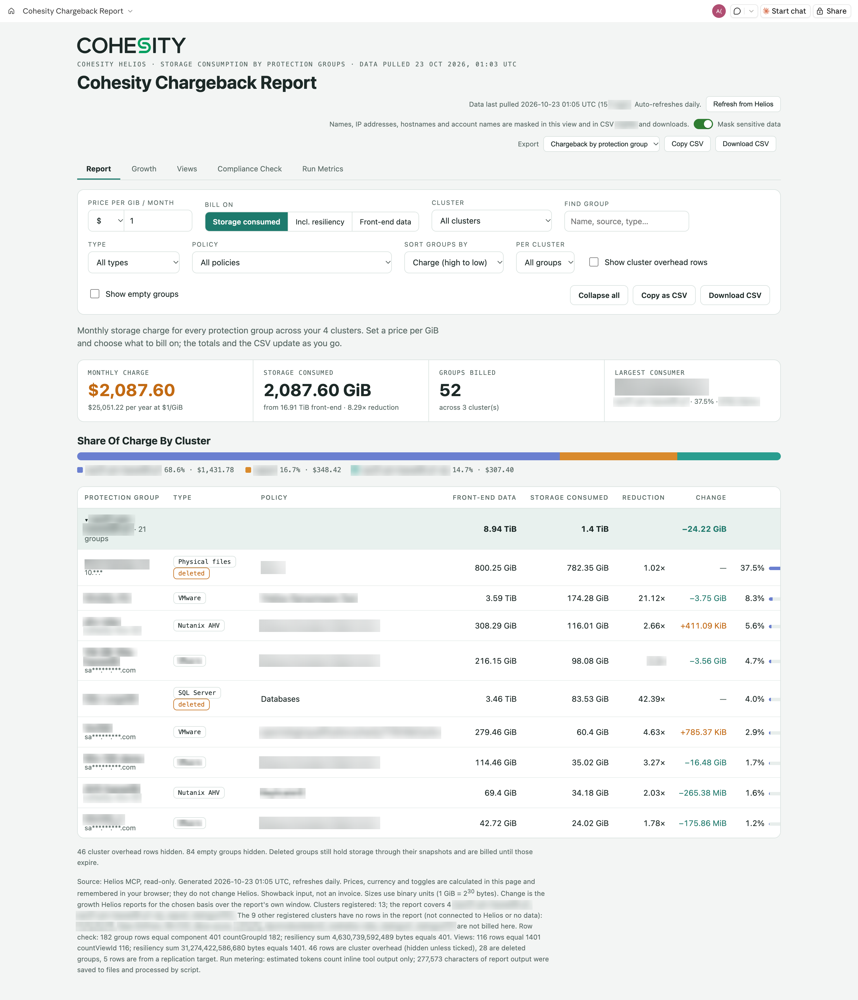
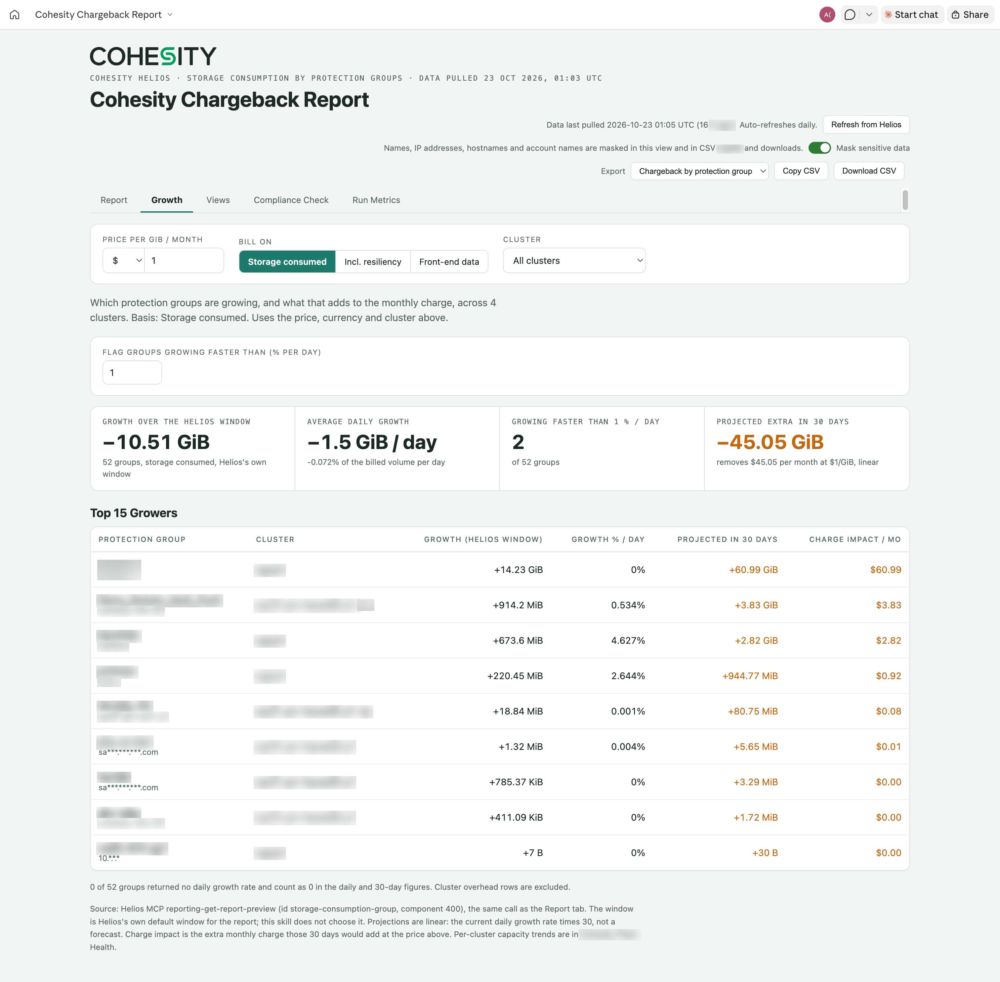
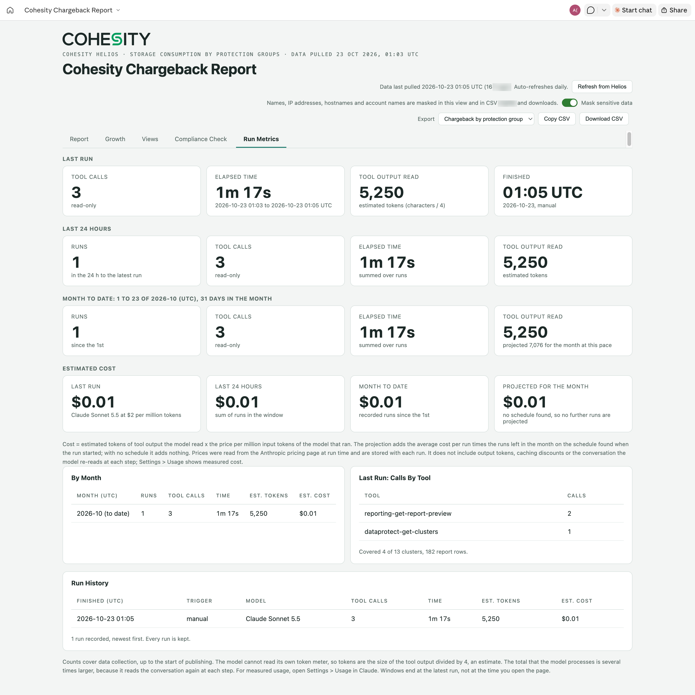
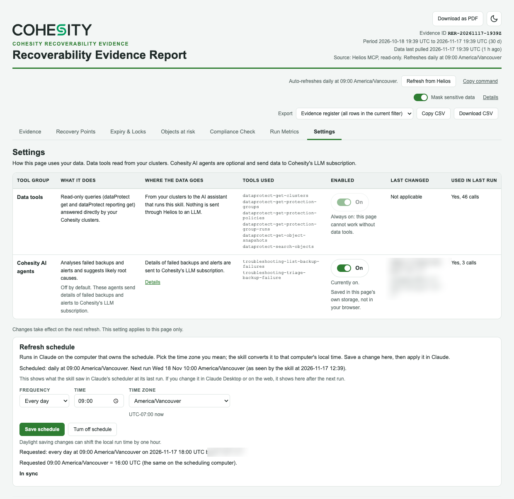
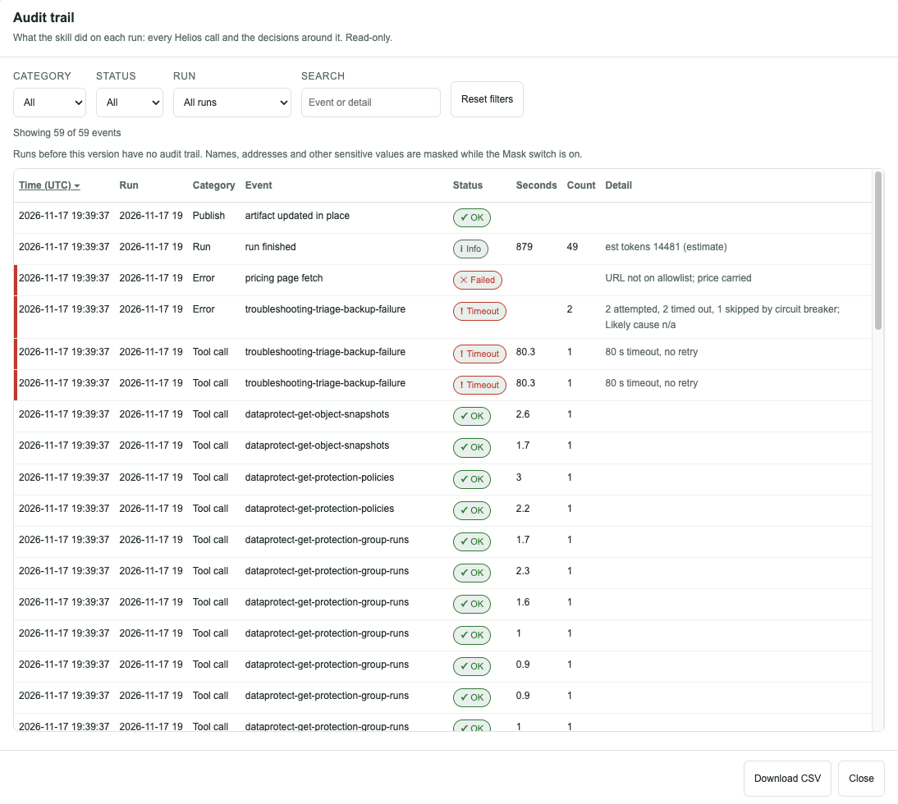

Copyright Cohesity 2026, SPDX-License-Identifier: Apache-2.0

# Chargeback: Claude Sample Output

Sample output of the Claude skill [`Cohesity-Chargeback-Report/SKILL.md`](Cohesity-Chargeback-Report/SKILL.md). For install and use, see the [main README](../README.md). Every page has the Cohesity logo top-left, a single sun/moon theme button top-right (follows the browser, a click flips this view, resets when the browser changes), "Data last pulled" with its age, and a copyright footer. Screenshots are from the published artifact (lab data); hostnames, cluster names and other identifying values are blurred.

## Report

## Growth

Which protection groups are growing and what that adds to the monthly charge.

## Views

Storage consumed by views, billed at the same price.

## Compliance Check

Checks the metadata shown on the page for personal data, secrets and infrastructure details before the page is shared.

## Run Metrics

Tool calls, elapsed time, estimated tokens and estimated cost for the last run, the last 24 hours and the month to date, a Tool availability table (each Helios tool, its status and why) and the full run history. An **Audit trail** button on the run history opens a read-only pop-up of every Helios call and decision of each run (filter by category, status and run, search, CSV). A **Pricing source** card under the estimated cost lets an editor of the page set where the skill looks up the model price (default: Anthropic's public pricing page; a link to a page or Excel/CSV file with a negotiated rate also works).

## Settings

The last tab explains how the page uses your data: the Helios data tools query your Cohesity clusters directly and nothing is sent through Helios to an LLM. The tab is a table with one row, Data tools (always on). Below the table, the **Refresh schedule** card shows the schedule the skill saw in Claude's scheduler at its last run and lets editors of the page request a frequency, day, time and time zone (or off). The request is saved in the page database; the skill converts it to the local time of the computer that runs it and applies it at its next run (Claude must be open on that computer; scheduled tasks may move to the cloud later). The page needs the `downloads`, `db` and `user` capabilities; the skill asks nothing before or after a run.

## Also on the page

A three-sentence summary at the top of the Report tab, a Download as PDF button (builds one PDF with a section for every report tab, never Settings, in the browser, loads two libraries from cdnjs.cloudflare.com on first click, saves through the downloads capability), monthly trend sparklines and a Charge by month chart with an optional budget (kept in your browser only), a footnote for figures typed in by hand, and masking of cloud account ids, ARNs and Azure ids. The Settings tab is the shared Settings block. A Mask sensitive data switch (on by default) also shortens protection group and view names to their first two letters plus `***`.

## Settings

The Settings tab is the same on every Cohesity skill page. It lists what the page reads and where the data goes (the Helios data tools only; this skill has no Cohesity AI agents switch), plus the **Refresh schedule** card.

## Audit trail

The **Audit trail** button in the Run Metrics tab (Run History card) opens a read-only list of every Helios call and decision of each run, with filters for category, status, run and search, and a CSV download.

